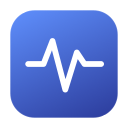

<p align="center">
  
</p>

<h1 align="center">MacSense</h1>
<p align="center">A native macOS system monitor. Your Mac, at a glance.</p>
<p align="center">
  <a href="LICENSE"></a>
  
  
</p>
<p align="center">
  <a href="README.ru.md">Русский</a> · <a href="https://github.com/behruzinho/MacSense/releases">Downloads</a> · <a href="https://github.com/behruzinho/MacSense/issues">Report an issue</a>
</p>

MacSense brings CPU, memory, GPU, battery, storage, network, temperatures, and fan speeds into one native SwiftUI dashboard. Metrics come from your Mac through Mach, IOKit, AppleSMC, and system tools. Core monitoring has no third-party runtime dependencies or analytics. Detailed NVMe SMART can optionally use an independently installed `smartctl`.

Created by **[behruzinho](https://github.com/behruzinho)**.

## Download and install

**[Download MacSense 0.2.0 — DMG](https://github.com/behruzinho/MacSense/releases/download/v0.2.0/MacSense-0.2.0-arm64.dmg)** · [ZIP](https://github.com/behruzinho/MacSense/releases/download/v0.2.0/MacSense-0.2.0-arm64.zip) · [SHA-256](https://github.com/behruzinho/MacSense/releases/download/v0.2.0/MacSense-0.2.0-arm64-SHA256SUMS.txt)

Download the DMG for your version from [Releases](https://github.com/behruzinho/MacSense/releases). Open the disk image and drag **MacSense.app** to **Applications**. A ZIP containing the same app and SHA-256 checksums are also provided.

**Requirements:** macOS 14 or newer. The downloadable binary is for **Apple Silicon (arm64)**. Intel users can build from source; this release does not include a tested Intel binary.

**[MacSense 0.2.0](https://github.com/behruzinho/MacSense/releases/tag/v0.2.0)** includes the expanded dashboard, storage tools, grouped cleanup and configurable monitoring panels.

The 0.2.0 downloads are signed with Developer ID Application and hardened runtime. **Apple notarization completed on 6 November 2026.** Tickets are stapled to the app and DMG; the ZIP includes the stapled app. The signing and notarization status of each download is stated in its release notes. Keep Gatekeeper enabled; see [Apple’s guidance](https://support.apple.com/102445) if macOS reports a launch restriction.

## Features

| Area | Available information |
| --- | --- |
| Dashboard | Live overview with compact charts and hardware details |
| CPU | Interval load, per-core usage, user/system split, active processes |
| Memory | Physical usage, wired and compressed memory, file cache, pressure, swap |
| Battery | Charge, health estimate, cycles, capacity, temperature, voltage, current, power |
| Cooling | Read-only SMC fan RPM and temperature sensors |
| Graphics | GPU identity, core count, utilization, temperatures, Metal families and memory budget |
| Storage | Physical disks, APFS hierarchy, live read/write statistics, bounded speed test, basic SMART and optional detailed NVMe SMART |
| Network | Receive/send rates and 64-bit interface counters |
| Applications | Nested app folders, total sizes including exact-ID related files, containers/scripts, grouped and batch selection |
| Cleanup | Caches, logs, developer data, downloads, large downloads, installers, disk images and Mail Downloads; progress and cancellation |
| Startup | launchd permission/loaded status, reviewed user-agent switches, MacSense launch at login and macOS settings |
| Extras | Configurable live panels and menu bar metric, themes, refresh intervals, pause, text report export |

## Languages

Switch languages in **Settings → Language and appearance**, without restarting:

- Русский — Russian
- English
- 简体中文 — Simplified Chinese
- Español — Spanish
- Deutsch — German

Labels, messages, confirmation dialogs, reports, dates, and units follow the selected language. System-generated macOS menus and window titles may follow the system language.

## Privacy and file operations

Telemetry is processed locally. MacSense does not upload hardware details, process lists, or file inventories. Profile and support links open in your browser when clicked.

The cleanup scanner checks user caches/logs, Xcode DerivedData/Archives/device support, top-level Downloads (including large items ≥500 MB, disk images and installers), Mail Downloads, simulator directories and `/Library/Logs`. Simulators and system logs are **view only**. Personal files and build archives are not automatically classified as junk.

The uninstaller scans `.app` bundles up to three folder levels under `/Applications` and `~/Applications`. Exact bundle identifiers match caches, preferences, support data, saved state, containers and application scripts. Shared Group Containers and unknown leftovers are excluded. No automatic cleanup runs; selected files move to Trash only after confirmation. Serial numbers are hidden until explicitly revealed and are excluded from text reports.

Directory-size scans have a time limit; **≥** indicates a partial size. Some protected folders may not be accessible.

## Current limits

- Sensor, GPU, NVMe, S.M.A.R.T., and TRIM data depend on the Mac model and macOS version. Unavailable readings are shown explicitly.
- Unknown temperature sensors retain their original SMC key; exact locations vary between models. CPU temperature is the average of the matched CPU sensor group.
- macOS controls fan speeds. Manual fan control and changing TRIM settings are not included.
- User-agent switches change future launchd permission; they do not terminate already loaded processes. System agents/daemons and third-party login items are managed in macOS Settings.
- Process CPU percentages come from `ps`; memory is RSS. This is not a complete Activity Monitor replacement.
- Detailed NVMe SMART requires a separately installed `smartctl` in `/opt/homebrew/bin` or `/usr/local/bin` and permission to read the drive. It is not bundled, installed automatically or run through `sudo`. Missing SMART values remain unavailable.
- The speed test writes/reads one unique 64–1024 MiB scratch file on the chosen folder’s drive, with file caching disabled, and removes it after completion or cancellation. Results depend on workload and the filesystem.
- Model release/factory dates, custom widgets, privileged helpers, manual fan control, TRIM changes and automatic updates are not included in 0.2.0.
- [Sensei comparison checklist (Russian)](docs/SENSEI_CHECKLIST.ru.md) · [Manual review checklist (Russian)](docs/TESTING.ru.md).

## Build from source

Install Xcode or the Xcode Command Line Tools with **Swift 5.10+**:

```sh
git clone https://github.com/behruzinho/MacSense.git
cd MacSense
./script/build_and_run.sh
```

The script builds, stages, signs, and opens `dist/MacSense.app`.

```sh
swift test                              # telemetry, file boundaries, localization checks
./script/build_and_run.sh --build        # build the .app without launching
./script/build_and_run.sh --verify       # build, launch, check the process
./script/build_and_run.sh --debug        # launch with LLDB
./script/build_and_run.sh --logs         # launch and stream logs
./script/package_release.sh             # optimized .app, DMG, ZIP, checksums
```

DMG packaging uses `dmgbuild` in an isolated `.build/dmg-tools` Python environment. The packaging script installs the pinned build dependency when needed; it is not bundled with the app. The installer has a Retina background and a saved Finder layout. License and installation notes are included in `.Documentation` inside the image.

Read-only diagnostics:

```sh
./dist/MacSense.app/Contents/MacOS/MacSense --diagnostics
```

To cross-build, set `MACSENSE_ARCH=arm64` or `MACSENSE_ARCH=x86_64`. Build success does not replace testing on the target hardware.

Optional release configuration:

```sh
MACSENSE_SUPPORT_URL='https://your-verified-support-page.example' ./script/package_release.sh
```

A real HTTPS support URL enables the coffee button. It is written to `MacSenseSupportURL` in the generated Info.plist. The app contains no payment credentials or embedded checkout. Until a page is configured, the button remains disabled.

If a Developer ID Application certificate and its private key are available, `MACSENSE_SIGN_IDENTITY` selects that identity and enables hardened runtime signing with a secure timestamp:

```sh
MACSENSE_SIGN_IDENTITY='your Developer ID Application identity' ./script/package_release.sh
```

Configure notarization once in your own terminal. The setup script prompts for your Apple ID and an app-specific password and stores credentials in Keychain; never add them to the repository:

```sh
./script/configure_notary.sh MacSense-Notary
./script/notarize_release.sh MacSense-Notary
```

The notarization script submits the signed app, staples its accepted ticket, rebuilds the packages, submits and staples the DMG, validates the tickets, and updates checksums. Do not rebuild or re-sign the app afterward without notarizing the new build. Without a Developer ID identity, local builds use an ad-hoc signature.

## Project layout

```text
Sources/TelemetryBridge/      C bridge to Mach, IOKit, AppleSMC, network counters
Sources/MacSenseCore/         Models, telemetry, file scanning, localization resources
Sources/MacSense/             SwiftUI app, state store, views, presentation helpers
Tests/MacSenseCoreTests/      Calculation, file policy, and localization checks
Resources/                   App icon and source icon images
script/                      Build, run, icon generation, and release packaging
```

## Contributing

Bug reports and pull requests are welcome. For sensor issues, include your Mac model, macOS version, and the affected sensor key. Remove personal information before sharing diagnostic output. Run `swift test` and build the app before submitting a change.

## Support and credits

Thanks to **[behruzinho](https://github.com/behruzinho)** for the idea and creation of MacSense. A “Buy me a coffee” button is included in the About window and Settings; the payment page has not been connected yet.

The interface is inspired by desktop system monitors such as [Sensei](https://cindori.com/sensei). MacSense is an independent project with its own implementation and assets.

## License

[MIT](LICENSE) © 2026 [behruzinho](https://github.com/behruzinho).
